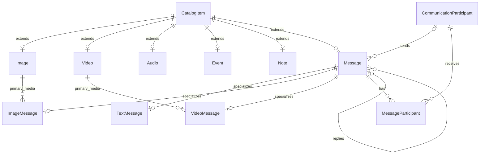

# Catalogue and communication domain model

Pandect's catalogue domain is split across focused Django apps. Together they
define the first source-neutral investigation records without adding a source
connector, resolved identity graph, conversation model, search index, or
analytical conclusion.

## Relationships

## App boundaries

- `pandect.catalog` owns the shared `CatalogItem`, common validation and rooted
  deletion behavior, atomic construction services, and the catalogue browsing
  interface.
- `pandect.photos`, `pandect.videos`, `pandect.audio`, `pandect.events`, and
  `pandect.notes` each own their corresponding concrete catalogue record.
- `pandect.messages` owns communication participants, the shared `Message`,
  recipient links, and concrete text, image, and video message records. Its
  media message types reference the standalone records owned by the photo and
  video apps.

The concrete apps depend on `catalog`; `messages` additionally depends on
`photos` and `videos`. No concrete app imports another unrelated concrete app.
This keeps source-neutral catalogue coordination separate from cohesive domain
records without introducing a generic plugin system or registration framework.

The implementation uses explicit one-to-one extension tables instead of deep
Django multi-table inheritance. Every record begins with a `CatalogItem`, whose
`item_type` names the concrete representation. The related object is then
loaded predictably through `item.image`, `item.video`, `item.audio`,
`item.event`, `item.note`, or `item.message`; message subtypes continue through
`message.text_message`, `message.image_message`, or `message.video_message`.
This keeps type-specific fields off unrelated tables and requires no
polymorphism dependency or generic foreign key.

## Models and cardinality

- `CatalogItem` is the stable UUID-based chronological record shared by every
  item. Its concrete choices are image, video, audio, event, note, text message,
  image message, and video message.
- `Image`, `Video`, and `Audio` hold optional Django storage references and
  already-known media facts. They are standalone catalogue records. Image and
  video records may also be referenced by their corresponding message type;
  audio deliberately has no `AudioMessage` subtype.
- `Event` records an optional end and description. A known end cannot precede
  its known occurrence time.
- `Note` contains a non-whitespace plain-text observation.
- `Message` contains the fields common to communication: an optional body,
  zero or one sender, zero or more recipients, and an optional direct reply.
- `TextMessage` requires the parent message body to contain non-whitespace
  text. `ImageMessage` and `VideoMessage` allow an empty caption and reference
  one primary standalone media record.
- `MessageParticipant` is the explicit recipient join. A recipient has one of
  `to`, `cc`, `bcc`, `mentioned`, or `unknown` for that link. The database
  prevents the same participant and role from being repeated on one message,
  while allowing the same participant in different roles. `message.recipients`
  therefore returns role-bearing `MessageParticipant` links rather than a
  potentially ambiguous list of distinct participants.

A `CommunicationParticipant` is the identity visible in a communication
context: a displayed name, address, username, phone number, account identifier,
or an incomplete placeholder. It is intentionally not a claim that the record
is a resolved real-world person or organization. Cross-source identity
resolution remains deferred.

## Timestamp definitions

- `occurred_at` is the best-known original time: sent time for a message, start
  time for an event, capture or creation time for media, or an explicitly
  supplied subject time for a note. It remains null when unknown.
- `catalogued_at` is when the item first entered Pandect. It defaults to the
  current time and never substitutes for an unknown `occurred_at`.
- `created_at` and `updated_at` are database-record audit times.

Datetime model validation rejects naive input. With Django timezone support
enabled, stored and returned values are timezone-aware. Default catalogue
ordering is ascending known `occurred_at`, then `catalogued_at`, with unknown
occurrence times last.

Catalogue models run `full_clean()` for ordinary `save()` and `create()` calls,
so model and cross-field validation is applied consistently. Bulk ORM writes
such as `update()` and `bulk_create()` bypass Django model methods and are not a
supported domain write path. Use `create_catalogued_item()` and
`create_catalogued_message()` from `pandect.catalog.services` for atomic
multi-table creation; a validation failure then rolls back the catalogue root
and every extension created so far.

## Catalogue intake and metadata review

The catalogue interface has explicit single-item intake for every current item
type. The first step captures the primary content needed to create a valid
record: an original file for standalone media, a description for an event, note
or message text, or an existing standalone media reference for a media message.
After construction, a type-specific review form exposes only the shared and
concrete fields that apply to that record. Message review also accepts a sender,
reply target, and recipients in `display name | identifier | role` format.

Bulk intake is intentionally limited to original image, video, and audio files,
where automatic local inspection is meaningful. One request accepts at most 50
files, 2 GiB per file, and 8 GiB per batch. A streaming handler counts actual
bytes rather than trusting a supplied content length, and preserves a 2 GiB
free-space reserve. Failed/rejected batches roll back provisional originals and
catalogue rows without altering previously committed evidence.
Pandect validates every file before constructing the batch, detects the media
type from file bytes instead of trusting the browser-provided type, and then
walks through the same review form for each created item. A bad file prevents
the entire batch from being catalogued.

PNG, GIF, JPEG, BMP, WebP, TIFF, AVIF, HEIC, and HEIF images are recognized.
MP4/QuickTime, AVI, WebM/Matroska, Ogg, and MPEG video containers are recognized.
WAV, FLAC, MP3, AAC, AIFF, CAF, AMR, Ogg audio, M4A, and audio-only
MP4/QuickTime/WebM/Matroska files are recognized. ISO-BMFF and EBML are container
formats rather than reliable media-type signatures, so intake uses a bounded
15-second `ffprobe` stream summary for those containers, including AVIF,
HEIC/HEIF, M4A, MP4/QuickTime, WebM, and Matroska. They are rejected with an
actionable message when `ffprobe` cannot establish stream truth rather than
silently being recorded under the wrong type.
The probe runs in the isolated, network-disabled media runner. It shares one
slot with background media work; a busy/unavailable runner yields an actionable
503 response and `Retry-After`, never direct decoding in the web service.

Original filename and media type are recorded, image/video dimensions are
extracted when their headers or the bounded probe exposes them, and a title is
derived from the filename. Video and audio duration, original occurrence times,
and facts requiring deeper decoding remain visibly unknown for operator review.
Review fields may be left blank; Pandect does not replace unknown evidence
metadata with guesses.

Uploads are stored unchanged through Django's local default storage. Signature
inspection reads a bounded prefix; ambiguous-container probing receives the
selected file through the isolated runner. Neither path rewrites or normalizes
the original. After a media extension is created, its canonical `file` storage pointer
cannot be reassigned through instance, queryset, or bulk model writes. A future
replacement operation must be an explicit provenance-aware service that binds a
new processing run; ordinary metadata edits are not a replacement path. The
signed review sequence carries catalogue IDs between ordinary
server-rendered pages without adding session state or a new import-batch model.

## Media storage and deletion

File fields use Django's default storage beneath `PANDECT_DATA_DIR/media`; the
database stores storage-relative names, not arbitrary absolute machine paths.
An image or video message keeps only a foreign key to its primary media record,
so media file data is not duplicated. The reference uses `PROTECT`: catalogued
media cannot be deleted while any media message still uses it.

`CatalogItem` is the only deletion root. Individual and queryset deletion on an
image, video, event, note, message, or message subtype is rejected, preventing
orphaned chronological records and avoiding different instance/queryset
semantics. An unprocessed item's related `CatalogItem` can be deleted, cascading
to its concrete extensions. Once immutable processing results, artifacts,
timestamp evidence, remote consent, or identity observations depend on that
item, protected relationships reject parent deletion instead of bypassing
append-only guards. Processing run/stage deletion is similarly blocked where
immutable evidence depends on it; a protected-deletion error is intentional.
There is no purge or soft-delete interface. These safeguards apply to supported
ORM/application paths, not direct trusted-operator SQLite/file edits.

Where deletion is permitted, deleting a message leaves referenced media intact. Replies to a
deleted message are retained with `reply_to` set to null. Deleting a participant
sets sender references to null and removes recipient links. Django does not
automatically delete the underlying stored file when a media database record is
deleted; file removal requires a future explicit, evidence-aware operation.

## Extension points and deferred concerns

An item's explicit `item_type` is immutable after creation. To add a catalogue
type, add an `item_type` choice, place a cohesive one-to-one model in the app
that owns that capability, add its type validation, register it in the
appropriate atomic-construction mapping in `pandect.catalog.services`, add an
app-local migration, and write focused tests. To add a message type, add a
concrete message item choice and a one-to-one extension of `Message` in
`pandect.messages`; update the shared set of valid message types and the message
service mapping. Future mixed or multiple media should use a separate
`MessageAttachment` join rather than adding more nullable attachment columns to
`Message`.

The separate processing and identity capabilities intentionally advance the
former processing/provenance deferral without putting extracted facts into
editable catalogue columns; see [`processing.md`](processing.md) and ADR 0002.
Conversations, threads, arbitrary item relationships, raw source imports,
source-native identifiers, platform fields, source connectors, search,
annotations, and mixed/multiple attachments remain deferred from this domain
layer.
