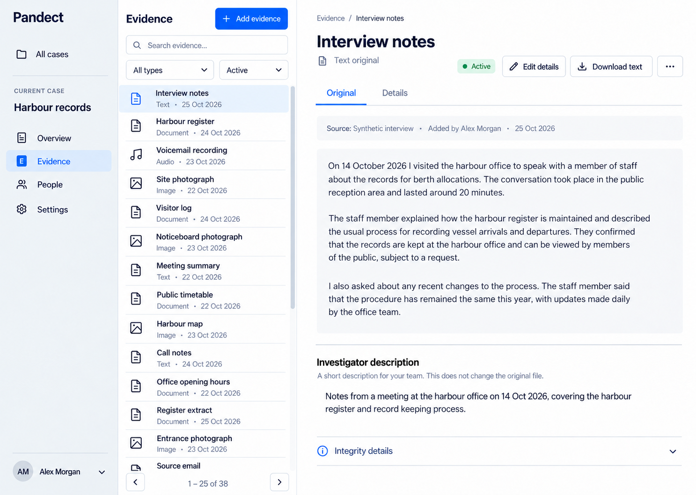

# Investigator interface specification

**Status: core interfaces implemented; validation results are reported separately.**
The selected visual direction is option 3, refined to show more evidence in the
same viewport. This document remains the behavioral and visual acceptance
specification; the mockups are references rather than proof of rendered behavior. Follow [the design standard](../DESIGN.md) for durable visual,
accessibility, and interaction requirements. See the
[delivery plan](interface-plan.md) for implementation order and validation.

## Confirmed product decisions

- Deliver core workflows: account access, cases, people, vehicles, the ten
  retained evidence types, invitations, and collaborator management. Implemented
  extraction, reports, and processing review are described in [case analysis](analysis.md).
- Retain individual evidence records and their originals. Owners and editors can
  archive and restore them; current case members can still inspect/download them.
  Only deleting an entire case removes its retained evidence.
- Support everyday batches through sequential uploads, visible outcomes, and
  individual retry. Do not require a queue service for bounded original storage.
- Use the existing Django/allauth/PostgreSQL foundation, explicit UUID primary
  keys, and current case roles. No ordinary user needs staff access.
- Broader graphs, unified timelines, identity resolution, ownership transfer,
  and self-service account deletion remain later work. Only implemented
  capabilities belong in navigation.

## Shared interface refinements

Management screens use consistent section dividers, readable detail and form
widths, aligned actions, and explicit filter recovery. On small screens, case
navigation uses a three-column grid; controls and actions wrap with the content.
Account navigation identifies the current settings page.

Add evidence uses a labelled type selector and an explicit **Choose type** button
that works without JavaScript. All ten types remain available. The form starts
with the original material and then its investigator description and source
context. Bulk upload and CSV import remain adjacent alternatives.

Analysis selection, assumptions, external-processing approval, and review fields
use the same field rendering as other forms, including help and error links.
Assumptions open after validation errors, and enhanced error links reveal any
containing disclosure before focusing the field. Processing progress has a native
progress indicator; findings retain their source links, individual reviews, and
full provenance downloads. Reports identify their selected subject in the heading.

These refinements preserve the three-pane evidence layout and its row-density
targets. Validation commands and capture locations are in
[browser checks](validation.md#browser-checks).

## Visual reference and density

The [selected initial reference](design/evidence-workspace-reference.png) establishes
the three-pane layout. The [density refinement](design/evidence-workspace-dense.png)
reduces list padding and repeated headers while preserving the reading pane.
These are synthetic design mockups, not implementation screenshots. Current
browser captures are generated separately during validation. Behavior and
accessibility requirements in this specification take precedence
over incidental mockup text or rendering details.

| Region | Desktop specification |
| --- | --- |
| Case navigation | `13rem` wide; compact case name, All cases, Overview/Evidence/People, owner Settings, account menu. |
| Evidence list | `20rem` wide; heading and Add evidence, search, then type/state filters. |
| List chrome | At most `164px` for heading/search/filters, with a `44px` pagination footer at default zoom. |
| Evidence row | At least `56px` high: `16px` title and `14px` type/date line; one whole-row link. |
| Reading pane | Flexible width, compact heading/actions, readable original, concise source strip, optional details. |
| Visible rows | At least 12 at `1440 × 900`, and 14 at `1440 × 1024`, for ordinary titles at default zoom. |

The row target is a visual acceptance criterion, not a pagination size or fixed
height. Use 25 records per page. Larger text and wrapped titles increase row
height. Keep secondary row actions in the reading pane. Do not shrink body text,
hide focus, or crop record names to make another item fit.

Use a split workspace at `80rem` and above. Between `64rem` and `80rem`, use the
case sidebar plus a list or detail page. Below `64rem`, use compact top navigation
and one content page. On mobile the list opens a separate detail page with a
clear Back to evidence link; three narrow columns must never be squeezed together.
At short viewport heights and high zoom, prefer normal document scrolling.

## Navigation and screens

The authenticated landing page is **All cases**. Anonymous users go to sign-in;
authenticated users without a verified email go through allauth verification.
Preserve safe local return destinations through sign-in and verification.

| Screen | Content and primary action |
| --- | --- |
| All cases | Searchable owned/shared case list, role, creation/update dates; **Create case**. |
| Create case | Required case name, optional description; **Create case**. |
| Case overview | Name, description, owner, current role, evidence/people counts, recent evidence links; **Add evidence** for owners/editors. |
| Evidence | Active collection by default, query/type/archive-state filters, pagination, selected record when wide; **Add evidence** for owners/editors. |
| Evidence detail | Original, source summary, investigator description, declared details, integrity disclosure; **Download original** where applicable. |
| Add evidence | Choose files or captured text, then clear input-specific fields; **Upload files** or **Save text**. |
| Edit evidence details | Title, description, provenance, optional declared metadata; **Save changes**. |
| People | Searchable case list; **Add person** for owners/editors. |
| Person detail/edit | Name/contact details and investigator notes, timestamps; **Edit person** for owners/editors. |
| Case settings | Owner-only name/description editing, collaborator access, pending invitations, separate delete section. |
| Invitation acceptance | Named invitation after authentication and recipient verification; **Accept invitation**. |
| Account | Styled allauth email/password management and POST sign-out; account creation/recovery/verification use the same design language. |

Use **Settings** only for case owners. Other members see case metadata on Overview
and their role in context. On read-only screens show a concise Viewer explanation
where it helps. Do not show disabled edit actions throughout the interface.

### Cases

Case names are required, up to 255 characters; descriptions are optional. Assign
the current user as owner on the server. Ownership is not a form field. Existing
cases receive a name based on their current `Case #<UUID>` representation through
an additive migration; the interface can prompt owners to choose a clearer name.
Updating a case records an update timestamp; initialize that timestamp from the
original creation time when backfilling existing cases.

The All cases search is limited to currently accessible case names/descriptions.
Use owned/shared filters and newest-updated ordering, with a deterministic
creation/UUID tie-breaker. An empty first visit explains cases and offers Create
case. An empty filtered result offers Clear filters.

Deletion is a separate full-page owner confirmation showing the case name and
counts of people, vehicles, active evidence, archived evidence, and collaborators. Explain
that originals and case records are removed, accounts are retained, and this has
no in-app undo. Require an explicit acknowledgement and a final **Permanently
delete case** POST. Report case deletion without promising verified erasure from
storage or operator backups; existing storage-cleanup limitations still apply.

### Evidence browsing and reading

Use ordinary links for records, with the selected link marked `aria-current`.
Do not implement the collection as a custom ARIA listbox. On detail pages the
evidence title is the single page `h1`; the list heading is a lower-level heading.
When no evidence is selected, Evidence is the page heading.

Each selected record has a canonical URL carrying its case UUID, evidence type,
and evidence UUID. The type is resolved through a fixed allowlist, never an
arbitrary model name. Preserve query, type, state, and page when moving through
records or returning to the list. Search operates on title, description, source
description, source URL, and original filename where applicable; it does not
claim to search extracted content. Query input is capped at 200 characters.

Default filters are all types and Active. State options are Active, Archived,
and All. Archived search results and details have a textual Archived label.
Archive/restore is an explicit POST with a persistent confirmation message. When
archiving a selected item, keep its detail visible with the Archived label and
Restore action; remove it from the Active list without unexpectedly selecting a
different record. Moving to the next item follows normal record navigation.

The reading pane contains:

1. A compact breadcrumb/title and actions for Edit details, Download original,
   and Archive/Restore, according to role. Avoid an always-open overflow menu.
2. **Original** and **Details** links that are server-rendered views of the same
   evidence. A query parameter chooses the section; ordinary links work without
   JavaScript. Enhanced switching may preserve focus without creating custom tabs.
3. A concise source/uploader/added-time summary. Source collection time is labeled
   separately from upload time, with an explicit timezone when supplied.
4. Escaped, read-only captured text on Original for text evidence. File evidence
   shows its original filename, size, declared type, and an authorized download
   action; this release does not render PDFs, SVG, HTML, image previews, or audio
   players. Do not imply a parser verified a file's category or metadata.
5. Investigator description and source context as read-only prose, edited through
   Edit details. Details includes provenance and any supplied technical claims.
   Integrity details discloses the full SHA-256 and a copy action with a selectable
   text fallback.

An unavailable stored original shows a useful error and retry/contact-owner
guidance while preserving access to its metadata. It never discloses storage
paths, exception details, or a public media URL.

### Evidence creation and batch uploads

**Files** accepts images, audio, and documents using the existing file models.
**Text** accepts one pasted original at a time. **Location** captures an address
or coordinate pair with an optional observation time. **Person location** adds a
required person from the same case. All types include a Source name/citation,
source URL, source description, and collection time. Location originals and person
associations remain read-only after creation, with private JSON downloads.
A normal single-item HTML form is the complete fallback. JavaScript enhances
file selection into a local batch;
it is not required to add any supported evidence type.

**Bulk add files** is a dedicated page linked beside Add evidence on the case
overview and Evidence collection, and from the ordinary creation form. Its picker
and drag/drop append files without replacing pending edits. Shared source name,
URL, description, and collection time live in an optional disclosure. They follow
pending entries per field until individually overridden, including by a blank
value; **Use shared details** resets an entry's source overrides. Investigator
descriptions remain individual. Frozen and saved entries never inherit later
changes. Disable shared controls while uploading, and block file additions while
running or any confirmation is unresolved. Saved entries count toward the page's
queue limit. Once every entry is added or removed, **Start another batch** opens
a fresh page. If enhanced upload support is unavailable, explain the limitation
and link to the ordinary single-file form.

Default bounded limits are 20 entries per browser batch, 100 MiB per file, and
1 MiB of UTF-8 for captured text. Make these operator-configurable and display
the configured values. A batch is a sequence of individual requests, not a
single 2 GiB multipart request. Deployment body limits must permit one file plus
bounded metadata. Enforce file limits during streaming and validate received
size server-side; memory thresholds alone are not upload-size limits.

The batch screen uses a compact list with filename, editable title, evidence
category, and status. Filename provides the initial title. Browser
MIME/extension hints may suggest Image or Audio; otherwise default to Document.
The user can correct the category; this suggestion is not verification. A
Details disclosure on each pending entry contains description, source name,
source URL/source description, and collection time. Optional type-specific
technical claims can be entered on the ordinary create/detail form and remain
editable after upload.

| Entry state | Behavior |
| --- | --- |
| Ready | Editable details; remove from queue; validation before send. |
| Uploading | Freeze file/type/details; show transferred-byte progress and keep the next entries queued. |
| Saving | Uploaded bytes reached the server; show indeterminate saving until the record is confirmed. |
| Added | Link to the saved record; do not resubmit it when retrying the batch. |
| Failed | Explain validation/storage failure; retain values and permit retry or removal. After a confirmed noncommitting validation failure, allow correction and a fresh submission ID. |
| Outcome unknown | Explain interrupted confirmation; retry with the same submission ID to resolve the saved result before editing, removing, or replacing the entry. |
| Access removed | Stop queued writes and explain loss of access; do not continue blind retries. |

Allow **Stop after this file**, which stops pending entries without claiming to
cancel a request already saving. Warn before leaving an unfinished queue. Keep
queue contents only in page memory; do not persist investigation material to
browser storage. A reload may require file reselection. Successful items stay
saved. In a no-JavaScript form, explain when a browser file input needs reselection
after validation and preserve the other entered values.

Assign a fresh UUID submission ID per intentional item. Ambiguous retries reuse
that ID and return the existing record after checking current case access. A
deliberately repeated file receives a new ID and remains a separate record;
checksums do not trigger automatic deduplication. Retrying an archived item must
not create a new active copy.

Unchanged retries keep the same submission ID. If the server definitely rejected
the entry without committing a record, return it to Ready for corrections and
assign a fresh ID when submitting the changed payload. An ambiguous response must
be reconciled using the original frozen payload/ID before allowing corrections;
do not treat a timeout as proof that nothing was saved.

The text form uses a required title and original-text field with `strip=False`,
`wrap="soft"`, and browser autocorrection/capitalization disabled. Never trim or
normalize the received original. Explain that the checksum covers captured,
browser-submitted text; upload the source text file as a Document to preserve
its exact original bytes. Render saved text as escaped text with wrapping.

### Editing details

Owners and editors can edit evidence title, description, source URL/source
description, collection time, and optional type metadata. Group provenance and
technical claims under clear headings/disclosures. Original content, case,
uploader, upload timestamp, original filename, byte size, declared content type,
and checksum are read-only. There is no Replace original action.

Detect stale case/person/vehicle/evidence edit forms using their saved update timestamp.
On conflict, retain proposed values, explain that saved details changed, and
provide a way to reload/review before explicitly resubmitting. Do not silently
overwrite another investigator's changes or automatically merge their assertions.

### People

Use the current fields: first/last name, phone number, email, address, and notes.
Explain that at least one name, phone, or email is required; partial identities
are valid. Display missing details as Not recorded. Keep uncertain notes in the
investigator's own words. Matching contacts do not merge or verify identities.

Owners and editors can create/edit people. Only owners can delete a person,
through a separate named-target confirmation. This deletes the person record,
not evidence or another person with matching contact details. Case membership
and user accounts are separate from these investigative records. Case cannot
be changed through the person form.

### Vehicles

The implemented vehicle workflow follows People with make, model, year, color,
license plate, VIN, and investigator notes. Require at least a make, model, plate,
or VIN, allow partial identifiers, and display missing details as Not recorded.
Owners/editors create and edit; viewers inspect; only owners delete after a
named-target confirmation. Case is fixed after creation. Matching identifiers
do not establish ownership or link vehicles to people. Lists preserve search and
pagination context, and stale edits require reviewed resubmission. See
[vehicles](vehicles.md) for fields, routes, and administration.

### Collaboration and invitations

The owner sees a compact access table: owner (fixed), current collaborators with
Viewer/Editor roles, and pending invitations. Describe Viewer as able to inspect
material and Editor as additionally able to add/edit people, vehicles, and evidence and
archive/restore evidence. Changing a collaborator's role is an explicit save;
removal has a named confirmation and takes effect on subsequent requests.

Invite by email with Viewer as the default role. Show pending, accepted,
expired, revoked, and delivery-failed outcomes accurately. Owners can resend or
revoke pending invitations and change a pending role. Resend/role change rotates
the token; links expire after seven days. Do not offer ownership as an invite role.
Reject invitations to the owner or an existing collaborator and direct the owner
to the current member's role controls. Do not expose an account directory.

Acceptance is a separate GET confirmation followed by POST. Require an
authenticated account with a verified allauth email matching the recipient. The
flow supports both new registration and existing accounts, preserves the invite
through verification, and gives wrong-account users a clear sign-out/sign-in
recovery path. Do not automatically treat the invite as email verification.

Expired/revoked links offer a request-to-owner explanation. An SMTP failure leaves
a pending invitation with an honest retry state. Invitation creation/resend in the running application sends mail through the
configured development console or production SMTP mailer. Accepting an already-used
link must not create another membership or change a current member's role.

## Permissions and request interfaces

| Action | Owner | Editor | Viewer |
| --- | --- | --- | --- |
| Inspect case, people, vehicles, active/archived evidence; download originals | Yes | Yes | Yes |
| Add/edit people, vehicles, and evidence | Yes | Yes | No |
| Archive/restore evidence | Yes | Yes | No |
| Edit case metadata/manage access/delete case | Yes | No | No |
| Delete a person or vehicle | Yes | No | No |
| Permanently delete individual evidence | No | No | No |

Every operation requires current case access and an object belonging to that
case. Resolve parents and children together; UUID knowledge is not authorization.
Do not use staff/model permissions as the product access gate or allow a
superuser to bypass case isolation.

Use named Django routes with these shapes; retain existing allauth and operator
admin routes. All mutations use CSRF-protected POST, never GET.

| Route shape | Purpose |
| --- | --- |
| `/cases/`, `/cases/new/` | Authorized list; create. |
| `/cases/<uuid:case_id>/` | Overview. |
| `/cases/<uuid:case_id>/settings/`, `.../delete/` | Owner metadata/access settings; delete confirmation and POST. |
| `/cases/<uuid:case_id>/evidence/`, `.../new/` | Filtered collection; create one typed record per request. |
| `.../evidence/bulk/` | Owner/editor bulk-file review page; uploads use the existing creation endpoint. |
| `.../evidence/<type>/<uuid:evidence_id>/` | Original/details view, with preserved list query and `section=original\|details`. |
| `.../evidence/<type>/<uuid:evidence_id>/edit/` | Edit descriptive/provenance/type details. |
| `.../evidence/<type>/<uuid:evidence_id>/download/` | Authorized attachment, including captured UTF-8 text. |
| `.../evidence/<type>/<uuid:evidence_id>/archive/`, `.../restore/` | Idempotent lifecycle POSTs; no individual delete route. |
| `/cases/<uuid:case_id>/people/`, `.../new/` | Scoped list; create. |
| `.../people/<uuid:person_id>/`, `.../edit/`, `.../delete/` | Scoped inspect, edit, owner delete confirmation and POST. |
| `/cases/<uuid:case_id>/vehicles/`, `.../new/` | Scoped list; create. |
| `.../vehicles/<uuid:vehicle_id>/`, `.../edit/`, `.../delete/` | Scoped inspect, edit, owner delete confirmation and POST. |
| `.../invitations/new/`, `.../invitations/<uuid:invitation_id>/resend/`, `.../revoke/`, `.../edit/` | Owner invitation creation/delivery/role management. |
| `.../memberships/<uuid:membership_id>/edit/`, `.../remove/` | Owner role management and removal. |
| `/invitations/<opaque-token>/` | Recipient confirmation and POST acceptance. |

Out-of-scope records return a generic not-found response without confirming
existence. A current viewer submitting a prohibited mutation receives a useful
permission-denied response. An enhanced request whose session or membership
expires gets a structured authentication/access error rather than login HTML
being mistaken for a successful upload.

Case-material responses and invitation pages use private/no-store caching.
Invitation pages also use `Referrer-Policy: same-origin`. Redact invitation-token
path segments and investigation search queries from application, Gunicorn, and
proxy access logs; do not assume using a token digest in the database protects
the raw token in an ordinary request log.

Ordinary form submissions use validation pages and POST/redirect/GET. Enhanced
single-item upload requests ask for JSON and use the same authorization/forms:
success returns the saved `type`, UUID `id`, and canonical `detail_url`; failure
returns a stable `code`, safe message, and field-error mapping. Use `201` for a
new item, `200` for an idempotent retry, `400` for validation, `401/403` for
authentication/permission, `404` for inaccessible/missing parents, `409` for a
conflict, `413` for size limits, and `503` for temporary storage failure. Bound
metadata size as well as file bytes, and render safe errors when an upstream
body limit rejects a request before Django can format it.

## Accessibility and acceptance

- Core account, case, person, evidence, archive/restore, and invitation tasks work
  through full-page forms without JavaScript. Enhanced batching improves throughput.
- At desktop widths, list and reader are labeled regions, with skip links to
  each; independently scrolling regions must be keyboard reachable. Partial
  navigation updates history and announces selection without stealing focus.
- At mobile widths, filters and actions wrap without horizontal page scrolling;
  selecting an item opens its canonical page and Back preserves list context.
- Test empty/new case, no search results, missing fields, unavailable storage,
  denied/revoked access, expired invitation, stale edits, partial batch success,
  and uncertain upload confirmation alongside ordinary success.
- Verify light/dark, reduced motion, forced colors, keyboard-only use, a
  representative screen-reader flow, and `320`-pixel reflow/zoom. Measure record
  density from rendered screenshots, not the generated reference alone.

References: [Django file uploads](https://docs.djangoproject.com/en/6.1/topics/http/file-uploads/),
[Django upload settings](https://docs.djangoproject.com/en/6.1/ref/settings/#file-upload-max-memory-size),
[allauth invitation integration](https://docs.allauth.org/en/latest/account/advanced.html#invitations),
and [HTML textarea behavior](https://html.spec.whatwg.org/multipage/form-elements.html#the-textarea-element).
