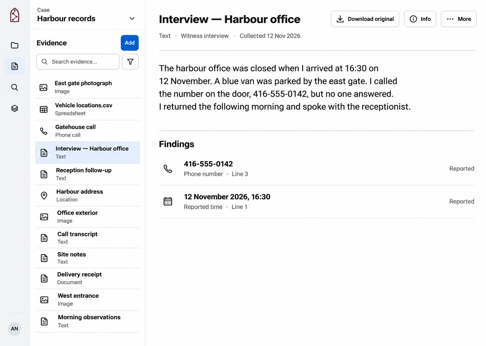

# Investigator interface specification

**Status: core interfaces implemented; validation results are separate.**
This guide owns screen behavior; [DESIGN.md](../DESIGN.md) owns shared design and
accessibility rules; [validation](validation.md) owns checks and procedures.
Generated mockups are references, not rendered evidence.

Public pages, sign-in, and the investigator workspace share the graphite and teal
palette, system sans serif typography, heading weights, and control radius from
`ui/static/ui/primitives.css`. Compact eyebrow labels and technical values use
the shared system monospace stack. `ui/static/ui/app.css` owns workspace controls
and navigation; domain styles reuse the semantic tokens. Public layouts retain
larger introductory headings, while investigator screens retain compact reading
and collection layouts. Light, dark, and forced-color modes share the same
foundation across these surfaces.

## Navigation and screens

Cases open to **Case Tools**. **Findings**, **Conversations**, **Trips**, and
**Images** lead directly to their respective readers or collections. Recent
evidence and findings precede the supporting tools and reports. **Case details**
holds ownership, role, dates, and the saved description.
Owners reach **Case settings** directly from the page header. Investigators need
no staff access. Graphs, case-wide inference of events from source content,
ownership transfer, and self-service account deletion remain planned.

All investigator screens, including All cases and account settings, share the
labeled rail and controls. Case screens link directly to **Case Tools**, **Evidence**,
and **Processing**. The rail becomes a compact top bar on narrow screens. Mark
the current destination and link the case name on supporting pages. Case Tools
is a full page. Disclosures work without JavaScript.

**Search this case** sits beside the case name on each case screen and wraps
below it on narrow screens. The case name goes to Case Tools and **All cases**
switches cases. **Filter evidence** and other collection searches only narrow
their own lists. The case search is a
GET form. With JavaScript, Ctrl/Cmd+K focuses it and two or more characters
offer up to six quick matches. Use arrows and Enter to open a record, Escape
to dismiss the suggestions, or submit the typed query for full results. Quick
matches look up active records case-wide. The results page applies the submitted
filters.

Case search results link to the matching source, highlight literal terms, and
label dates and source information. **Filters and sorting** provides a
record type, local date range, evidence state and keyword ordering; the URL
retains the query, filters and page. Keyword results load independently.
On eligible first-page searches, **Search by meaning** requests up to six
additional source passages from the configured private model. That section
reports incomplete or unavailable indexing and links to Processing.
**Search tips** describes phrases, alternatives and exclusions.

Cases, People, Vehicles, and Evidence use shared whole-row links with readable
titles and secondary metadata. Detail pages and forms share the reader's heading,
action, divider, and spacing styles. Info, More, and Filters retain their visible
labels on mobile. Edit details and Analyze evidence are directly available to
owners/editors in the reader. Analysis choices use a named disclosure; More keeps
secondary actions.

People and Vehicles retain list searches and pages through creation, editing,
deletion, and cancellation. Shared forms name choice groups with native legends;
error links focus the affected control or group.

| Screen | Content and primary action |
| --- | --- |
| All cases | Searchable owned/shared cases with roles; **Create case**. |
| Case Tools | Default case home; recent evidence and findings, supporting views, reports, and **Add evidence** for owners/editors. |
| Evidence | Active records, search and disclosed filters; **Add evidence** for owners/editors. |
| Processing | Pending reviews, active work, retained outcomes, and owner/editor **Reprocess evidence**. |
| Evidence reader | Original and Findings together; downloads, Info, and authorized More actions beside the title. |
| Conversations | Reported participant pairs, a unified message history with findings, and saved sessions with summaries and expandable originals. |
| Chronology | A daily timeline of conversations, calls, possible trips, sightings, and evidence collections, with links to supporting records. |
| Findings catalogue | Searchable retained source-linked results, with filters for evidence and method. |
| People / Vehicles | Searchable case records; owner/editor creation and editing, viewer inspection. |
| Case settings | Owner-only name/access management and a separate delete section. |
| Case details | Owner, timestamps, role, and saved read-only description for all case members. |
| Invitation | Named recipient confirmation after authentication and email verification; **Accept invitation**. |
| Account | Allauth email/password management, timezone preference, and POST sign-out, with the shared shell. |

Public `/` serves the same marketing overview to anonymous and signed-in visitors;
signed-in visitors have an **Open workspace** link to All cases. Public layouts
and content are owned by [marketing](marketing.md). Product routes require an
active authenticated account and verified email.
Preserve safe local return destinations through sign-in/verification. Email
settings show address/status and require named removal confirmation.

Display times and date/time fields in the device-detected timezone or the user's
**Account → Timezone** choice. Label the timezone and respect local midnight
boundaries. Source-export timezone choices remain explicit and independent.

**Chronology** opens on the latest day with activity. Use document scrolling
with newer dates above older ones and skip days without entries. Keep the date
picker and clock controls outside the day sections. The picker opens the exact
date, including empty days. Provide native form submission and plain navigation
links when scroll loading is unavailable. Date jumps and entry pagination support
browser Back and keyboard use.

Place each time or interval beside its entry and keep the real endpoints visible
for trips that cross midnight. At narrow widths, stack the time and description
in reading order. **Recorded chronology** opens individual timestamps and range
filters. Both views link to **Unplaced evidence and time claims**, including on
empty days. Separate undated originals from quoted temporal interpretations,
with independent pagination and links back to their sources. For clock roles,
source precision and grouping, see [Chronology](chronology.md).

## Visual reference and density

The synthetic [quiet workspace reference](design/quiet-evidence-reference.png)
guides the rail, collection, and reader. Actual processing output takes precedence
over illustrative findings; earlier references are historical.

Follow [DESIGN.md](../DESIGN.md#layout-and-density) for panes, breakpoints, rows,
and density. At default zoom, target at most `164px` for heading/Add/search/Filters
and `44px` for pagination. Use about `65ch` for original text; group supporting
metadata in Info.

Use 25 records per page and one whole-row link. Let long titles and larger text
expand rows to keep the full name readable. When no record is selected, the
collection fills the workspace. Selecting a record on a wide, tall window keeps
the collection beside the reader. Narrow or short windows open the canonical
detail with Back to evidence and document scrolling.

Case Tools, Processing, and analysis pages use the available workspace width.
Case Tools reflows its groups as space permits, with reading passages and forms
following the shared measures.

## Cases and investigative records

Case creation asks for a name and assigns the current user as owner server-side.
Search accessible names/descriptions with owned/shared filters and stable
newest-updated ordering. Empty collections lead with the available create action.
Filtered empty states keep the search and one **Clear filters** action. Case
settings leads with collaboration and discloses the rename form. Only owners
edit the name or collaborators. Saved descriptions remain read-only.

Person details show reported social accounts and POIs. Owners/editors manage
accounts with confirmed removal; viewers inspect. Search includes platforms and
usernames. Disclose saved notes/history read-only. Person/vehicle deletion links
sit below Record details, outside its disclosure, for owners. Vehicle headers
expose Add a location and Import vehicle locations beside Edit vehicle; adding a
location preselects the same-case vehicle. [People](people.md) and
[vehicles](vehicles.md) own identity, role, and deletion rules, including
retained-location protection.

Case deletion is a separate owner confirmation naming the case and inventory,
including people, vehicles, active/archived evidence, collaborators, and pending
invitations. Require an acknowledgement and **Permanently delete case** POST.
Explain that accounts remain, there is no in-app undo, and storage/backups may
retain copies; do not promise verified erasure.

## Evidence browsing and reading

Use ordinary links with `aria-current`. The selected title is the single `h1`;
the collection heading is lower-level. Canonical URLs contain case, allowlisted
type, and UUID. Preserve query, type, archive state, and collection page through
selection and return navigation.

Visible literal search accepts up to 200 characters across metadata, captured
text/messages, supplied transcripts, and supported completed extraction. Excerpts
link to originals/results; [analysis](analysis.md) owns extraction coverage.
**Filters** holds type and Active/Archived/All with **Apply filters**; reopen
non-default filters after navigation. Omit repeated ingestion dates from rows;
retain exact dates in history.

One reader header holds title, concise type/source/collection metadata, archive
state, and authorized download. Originals and source-linked Findings appear
together. **Findings (count)** near the title jumps past long originals.
Show all current findings citing this record or its attachments in pages of 25,
including weak findings with their qualifiers. Finding links return to the
same row and preserve the evidence list filters. **Analysis history** holds
all checks and saved reports that used the evidence. Findings, history, and
the evidence collection paginate independently.

Header disclosures:

- **Info** holds full source metadata, file details, saved descriptions, declared
  technical fields, record/integrity history, imported source context, retained
  attachment attribution, and a link to Analysis history.
- **Analyze evidence** lists the analysis available for the selected original.
  **Edit details** is visible beside it.
- **More** holds archive/restore, reruns, supported imports, and superuser deletion.
  Viewers can still open Info and download originals.

The Info pane has a named keyboard focus stop so Page Down can scroll long
attribution, integrity, and history without moving the original reader.
Native disclosures support keyboards and no JavaScript. Reveal invalid controls
before focusing their fields.

PDF originals provide Previous/Next links and a labeled **Page number** with
**Go to page**. Both preserve collection filters; invalid page requests offer
**Open first page**. Unsupported audio uses a plain playback-unavailable message
with a download action.

Every case role can download privately. Escape text; never embed untrusted
documents as application HTML. Missing originals retain metadata and show safe
recovery. Checksums remain fully selectable, with optional copy. Metadata edits
never change originals; changed originals become new evidence.

Archive/restore are explicit owner/editor POSTs. Archiving keeps the selected
detail visible, with Archived and **More → Restore**, while removing it from
the Active list. Current members can still inspect/download archived material. Individual
permanent deletion is reserved for superusers with current case access; show
originals, imported derivatives, analysis, and retained files in a complete,
paginated inventory with a full download. Bind confirmation to that inventory
and require another review if it changes. Cancellation preserves list context;
inconsistent cross-case links block deletion without exposing foreign records.
See [evidence](evidence.md) for the deletion and private-storage contract.

## Conversation reading

**Case Tools → Conversations** lists reported participant pairs, message counts,
and latest recorded times, loading 25 more pairs when scrolling to the end.
Opening a pair shows a compact chat reader loading 50 messages at a time, oldest
recorded time first and unknown times last. Put sender and time on one wrapping
line above the complete, selectable original. Keep sender names explicit and
participant alignment consistent; do not label either participant as the signed-in
user. Date separators and timestamps use the display timezone. Preserve message
whitespace and escape source content.

**Messages** is the default view. Combine imported and individually entered
messages in the pair's timeline. Keep short source references and archive labels.
Group confirmed matching copies from different exports in one row. **Retained
copies** gives access to each original's export, source row and details.

**Sessions & summaries** lists saved inferred sessions in chronological order.
Lead with a short excerpt of the saved AI summary when it covers the full session, with
a direct link to the cited report. **Full summary** opens the complete summary
with links from statements to their supporting findings. Display
the date range, message count and grouping details. **Show messages** opens
the original members inline, with separate paging for a long session. When a
full summary is missing, owners and editors can **Request summary** for that
session or **Summarize missing sessions** to review up to 50 saved sessions at a
time. The bulk review shows the eligible groups on that page, then links to the
batch in **Processing**. When there are no
saved groups, editors can use **Group this conversation** to review the active
messages for the pair.

Each message has a selectable link to **Message details**. On wide screens,
selection opens one named side panel and leaves the transcript in place.
On narrow screens, the details use the full reader width. Close or Escape
returns focus to the message. Real message URLs support Back, Forward and
JavaScript-disabled navigation.

Give all members of a saved inferred session the same tint. Label its first and
last cited messages, including single-message sessions. A page edge cannot
create a boundary. Keep uncited messages neutral. Show **Multiple
groupings** when different saved memberships cover the message, and link to
their findings in the panel. Selection, archive state and session boundaries
remain distinguishable without colour.

Message details show the original, reported participants, time and an archive
label when applicable. Use **Message source** for the retained export and row or
recorded collection details, and link to evidence Info for full import metadata.
Use **Inferred session** or **Multiple groupings** to disclose session context.
Start **Findings · N** open with up to three short previews. Link each title to
the full finding and retain applicable AI and partial coverage labels. **More
findings** opens the detailed list with 25 findings per page. Keep finding
pagination independent from message pagination. Expand **Conversation findings
(count)** above the transcript to preview up to three session or shared findings.
**More findings** opens the complete list, 25 per page. **Show message** opens a cited message. Show each shared finding once, explain citations
outside the participant pair, and retain complete source details through
**Open finding**. Do not repeat selected-message copies as analysis findings.

Use latest equivalent saved results. Mark individual model suggestions when a
run mixes AI and ordinary observations. Withhold finding content when analyzed
sources are unavailable or changed. Omit the shared disclosure when there are no
conversation-wide findings. Reading or expanding findings starts no analysis and requires no JavaScript.

In the details panel, **Open evidence** opens the canonical reader and native
reply/thread lists. Its **View in conversation** returns to the exact message
and page, opens details, and marks the target beyond color. Preserve the
conversation-list page throughout.

Tabs, expansion, and evidence links use ordinary GET navigation. Scrolling near either
boundary of the transcript, session list, or expanded messages adds the adjacent
page in place. Keep list context, deduplicate transcript date headings, and retain
focus and position when prepending. **Jump to date** uses the display timezone
and lands at the chosen day within the ordinary chronological pages.
Announce loading, completion, and failures; retain ordinary earlier/later links
for keyboard use, without JavaScript, and as full-page recovery after a failed
request. Each request uses the same authorized, bounded page route. Browser Back
preserves the selected record and page. Use ordinary page scrolling at every
screen size. An empty **Sessions & summaries** view links back to **Messages**.
See [evidence](evidence.md#reading-conversations) for interpretation limits.

## Evidence creation and batch uploads

**Add evidence** offers jump links for mixed-file **Upload files**, **Add a
record**, and **Import CSV** above the intake sections. Single-record forms name
the type and offer **Change type → Choose type**. All ten types work without
JavaScript. Single-file Document is the upload fallback.

Keep title/original fields visible. Disclose optional source/technical fields
on request, editing, or validation errors. Saved descriptions/notes remain
readable. New note authoring is retired. Preserve citations and legacy finding
review reasons.

The limits are 100 batch entries, 1 GiB per file, and 10 MiB UTF-8 captured
text; show the application limits. Each file is a separate request. A batch
row shows filename, editable title/type, source overrides, and state. Browser type
hints are suggestions, not verification. Shared source fields follow pending
entries until individually overridden, including by blank values; **Use shared
details** resets an override. Saved/frozen entries retain submitted values.

| State | Behavior |
| --- | --- |
| Ready | Edit or remove before sending. |
| Uploading / Saving | Freeze submitted values; show byte progress, then saving until confirmed. |
| Added | Link to the retained record; never resubmit a confirmed success. |
| Failed | Preserve values and offer retry/removal; confirmed noncommitting validation errors permit correction with a fresh submission ID. |
| Outcome unknown | Resolve the original frozen submission ID/payload before editing or removing it. |
| Access removed | Stop queued writes and explain the loss of access. |

Pickers and drag/drop append files without replacing pending edits. Block new
files and shared edits while uploading or awaiting confirmation. Saved entries
count toward the queue limit; removing all pending files restores the empty
picker. **Stop after this file** stops pending work without claiming to cancel a
request already saving. Keep queue state in memory, warn before leaving, and
explain file reselection after reload/validation. **Start another batch** opens
a fresh page after completion.

Pasted text preserves browser-submitted content without trimming or normalization;
offer document upload for exact file bytes. Adding eligible evidence queues
applicable analysis. Follow its status in Processing and results from Case
Tools or the evidence reader. Do not imply every file has a supported extraction
profile.

Vehicle-location CSV review leads with vehicle mapping and possible-duplicate
counts. Source-row preview is collapsed unless invalid rows need attention.
Completion links to Case Tools and discloses individual observations; the original
CSV and attribution remain accessible. See [imports](vehicle-location-imports.md).

## Instagram monitors

The optional [Instagram monitor workflow](instagram-monitors.md) shows each
direction's changes, two linked captures, coverage, and scheduled checks in a
case. Case owners approve the synthetic target in Case Settings. The connecting
investigator sees connection recovery, the last successful check, and the next
scheduled check in the monitor workflow. Retained live observations remain
visible to case members while live scheduling awaits an authorized source.

## Case Tools, Processing, and additional analysis

Case Tools gives owners and editors one primary **Add evidence** action.
The four main destinations come first, followed by up to three recent active
records and three recent source-linked findings. **More case tools** groups the
chronology, people, vehicles, repeated identifiers, sighting groups, eligible monitors, and
owner/editor **Additional analysis**. **Reports** opens the five report links.

**Sighting groups** opens saved proposals. Creation starts from an anchor
observation with labeled checkboxes for direct connections. Optional supporting
and contrary records stay in a disclosure. The group shows each pair with its
basis and links to the original evidence. Overlapping proposals and previous
reviews remain accessible from the detail. Owner/editor review uses ordinary
forms. Read-only historical states explain how to work from current evidence.

**Compare a claim** starts in **Additional analysis** with the retained-evidence
picker. The second step shows the eligible statement sources and accepts an
exact quotation. Results show the quoted claim, assessment labels and citations
in the ordinary analysis reader. Exact copies remain visible beside the other
selected sources. Processing owns progress and recovery.

Processing links directly to **Browse findings** and groups reviews and recovery
under **Needs attention**, with queued and running work under **In progress**.
Show up to three current failures for each of batch preparation, vehicle imports,
and trip/address preparation, with links to recovery and more history.
**Processing history** opens finished checks and filters for evidence type
and outcome. A selected batch opens all its checks. Result links preserve the
selected batch and history filters. **Analysis run counts** discloses totals
across saved outcomes, including partial, empty, insufficient and unsupported
results. Worker retries count as part of the original run. The totals cover the
whole case even when history is filtered.

Vehicle-location CSV imports retain their progress and review links. Preparation
and vehicle-import histories use native disclosures. **Checks queued** indicates
that preparation has queued work. Owner/editor **Analysis actions** includes
**Choose analysis** and **Reprocess evidence**. Reprocessing uses active evidence,
preserves earlier results and shows preparation progress.

While work is active, Processing, analysis results, evidence findings/history,
message and vehicle import reviews, and vehicle trip summaries update their
changing sections every five seconds with JavaScript. The original reader,
navigation, filters, URL, and interactive map remain in place. Focused sections
and edited forms wait for the investigator; open disclosures stay open. Polling
pauses in hidden tabs and stops when work finishes. Requests time out after 15
seconds; three consecutive failures pause updates with a manual retry. Session or
access loss stops updates and offers All cases. **Refresh status** also works
without JavaScript. Every fragment request repeats the page's current case checks.

**Reprocess evidence** opens a dedicated screen. Native checkboxes select
multiple active evidence types with counts. Invalid submissions retain choices
and link errors to their controls. Submit returns to the selected batch in
Processing, where results identify their execution destination and selection.
Viewers have no reprocessing action. Methods needing explicit samples, an area
or import interpretation keep their required context.

Case Settings is where an owner reviews configured destinations and approves or
revokes external analysis for the case. Keep the data transferred and the scope
of approval visible at that decision. Analysis forms collect the required source
and method inputs. When approval is needed to make a method available, provide
recovery based on the investigator's role.

Message CSV setup leads with the CSV and confirmed export timezone. Alternate
sources and **Limit by date** use disclosures. Review has one **Person** chooser
per participant, with **Create a person** and a native disclosure for new person
details.

The completed CSV review links to background analysis for newly published rows.
Show preparation, checks, live updates and a manual refresh fallback. Preparation
finishing means checks are queued. Each result discloses the bounded selection
used. Rerun actions use the case's current available services.

**Case Tools → Additional analysis** and **Processing → Analysis actions →
Choose analysis** show
tasks in labeled groups with an optional evidence-type filter, then open a
source/context form. From the evidence reader, show compatible methods and
carry the open record into the source form. Keep
required samples, areas, and claimed events visible; disclose tuning in **Options**,
opening after errors. Keep retained source versions explicit.

**Compare plans with locations** opens separate statement and observation
pickers. Select a quotation, resolve repeated wording in context, then review
the interpreted subject, place and time before queuing. From a saved comparison,
open each cited passage, original observation or pinned trip membership. Keep
the claim status, contrary material and limitations beside the association.
See [plan and location comparisons](analysis-locations.md#compare-plans-with-locations).
Sources use 25-record pages; native POST navigation/title search preserve choices
and options. Show preparation links for blocked sources and Remove for any
retained selections that need it. Start analysis when at least one available
source can be selected and no selected source is blocked. Browsing never queues
work; execution/inference limits still apply.

Run overviews lead with findings and citations. Retained warnings remain open
under **Limitations**. **Details and history** holds downloads, selected sources,
settings, and **Run again**. Show the retained execution destination in run
details. Findings lists lead with the useful
preview, source and coverage. The closed **Filters** disclosure holds **Result
history**, with choices for latest and all saved results. Evidence-specific
lists put distinct findings with a useful next check first and show the reason
beside the finding. Distinct search matches remain under **Matching search details**.

Individual findings use a single reading column for the saved result and
**Cited evidence**, with the contextual back link above and any link to the
result list below. Put the **AI suggestion** label beside model output. Reserve
quotation styling for cited wording. Show each quotation or preview once, beside
its source link and provenance. Use recorded export rows for imported messages,
and identify supplied transcripts, saved extractions, estimates and quotations
from prior findings.

Keep decision-critical status, coverage, failure reasons and low-confidence
warnings visible. Summarize bounded import coverage when available. Distinguish
an exact citation match from the interpretation it accompanies. Use a closed
**Finding details** disclosure for secondary measurements, character offsets and
native IDs. Keep full retained warnings, selected inputs, settings, downloads,
history and **Run again** in **Analysis run details**. Metadata inspections
retain their property tables, and findings without primary content retain
structured values. Communication pairs lead with a factual interval heading
and compact messages with reported participants, localized time with timezone,
source link and body.

Hide timing-only message pairs by default across run results,
catalogue/person findings, conversations and case highlights. The individual
evidence reader includes current published timing-only findings. Full collections show a
hidden count and **Show all findings**; an all-hidden view explains its state.
Keep shared-word candidates, native reply context and AI suggestions visible.
Reveal state survives navigation. Direct finding URLs always open the original
indexed item.

Use the shared field renderer for labels, help, errors, and processing approvals.
Progress uses a native indicator; failures expose retry/recovery controls. Results
lead with output and sources before processing metadata. Use retained image
regions/crops, recording intervals, paired passages, message sequences, and
observation maps when supplied by the operation. Identifier normalization lives
in **Finding details** on individual findings.

Reports lead with a summary, visible coverage warnings, and key results before
individual records. Call patterns shows participant pairs with their call counts.
Exact file duplicates shows filenames and full group counts, with SHA-256 under
**File checksum**. Applied report filters are summarized in a closed disclosure
that opens automatically for validation errors. **About this report** holds methods and additional
calculations/selection details. Chronological/grouped sources use 25-record pages; totals
and comparisons cover the complete filtered selection. Participant pairs paginate
independently; thread/reply lists and vehicle observations retain complete paged
access. Structured lists/mappings use independent 200-value pages, preserving
filter/finding context and full downloads. Narrow rows stack with labels. Trips
show dates, endpoints, observed duration, and disclosed observations; omit repeated
vehicle names. Pagination does not imply exhaustive coverage or verified journeys.

## Collaboration and request behavior

Owners manage a compact owner/collaborator/pending-invitation table. Viewer is
the default invitation role; ownership is fixed. Role changes are explicit saves;
removal has a named confirmation and affects subsequent operations. Invitations
show pending, accepted, expired, revoked, and delivery-failed states honestly.
Preserve the invitation through registration/verification and offer wrong-account
recovery. Expired/revoked links explain how to contact the owner; failed mail
leaves a retryable pending invitation. See [cases](cases.md) for token lifetime,
rotation, verified-email matching, and acceptance/replay rules.

All mutations use CSRF-protected POST and current server-side case/object access.
Superusers receive no case bypass. Inaccessible objects return generic not-found
responses; prohibited viewer writes return permission-denied. Enhanced uploads
must distinguish structured authentication/access errors from successful JSON.
Use the same forms and authorization as ordinary submissions, with safe field
errors, idempotent retries, and no secret-bearing exception text.

## Accessibility and acceptance

Apply [DESIGN.md](../DESIGN.md#completion-and-design-review) for viewport,
keyboard, accessibility, and recovery checks. Use [validation](validation.md)
for check selection, executable commands, and synthetic capture locations.
